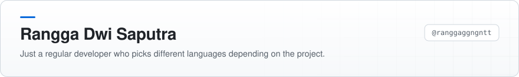

<picture>
  <source media="(prefers-color-scheme: dark)" srcset="./assets/hero-dark.svg">
  <source media="(prefers-color-scheme: light)" srcset="./assets/hero-light.svg">
  
</picture>

  <a href="https://www.linkedin.com/in/rangga-blaze/"><picture><source media="(prefers-color-scheme: dark)" srcset="./assets/btn-linkedin-dark.svg"><source media="(prefers-color-scheme: light)" srcset="./assets/btn-linkedin-light.svg"></picture></a>
  &nbsp;
  <a href="https://discord.com/users/833699017501835334"><picture><source media="(prefers-color-scheme: dark)" srcset="./assets/btn-discord-dark.svg"><source media="(prefers-color-scheme: light)" srcset="./assets/btn-discord-light.svg"></picture></a>

I build software across different domains, from backend services and tools to web apps, Unity games, and Minecraft servers.

### Focus

<table>
  <tr>
    <td width="50%" valign="top">
      <b>Backend &amp; Systems</b> 
      APIs, CLI tools, automation, and native software in Python, Rust, C, and Go.
    </td>
    <td width="50%" valign="top">
      <b>Web</b> 
      Web apps and full-stack projects with TypeScript, Node.js, PHP, React, and PostgreSQL.
    </td>
  </tr>
  <tr>
    <td width="50%" valign="top">
      <b>Unity</b> 
      Game development, gameplay logic, and tools built in Unity with C#.
    </td>
    <td width="50%" valign="top">
      <b>Minecraft</b> 
      Server plugins, addons, and custom mechanics across Java, Bedrock, and PocketMine.
    </td>
  </tr>
</table>

### Stack

<table>
  <tr>
    <td width="50%" valign="top">
      <b>Main</b> 
      <picture>
        <source media="(prefers-color-scheme: dark)" srcset="https://skillicons.dev/icons?i=py,rust,c,ts&amp;theme=dark">
        <source media="(prefers-color-scheme: light)" srcset="https://skillicons.dev/icons?i=py,rust,c,ts&amp;theme=light">
        
      </picture> 
      Python · Rust · C · TypeScript
    </td>
    <td width="50%" valign="top">
      <b>Also use</b> 
      <picture>
        <source media="(prefers-color-scheme: dark)" srcset="https://skillicons.dev/icons?i=java,cs,cpp,go,php,bash&amp;theme=dark">
        <source media="(prefers-color-scheme: light)" srcset="https://skillicons.dev/icons?i=java,cs,cpp,go,php,bash&amp;theme=light">
        
      </picture> 
      Java · C# · C++ · Go · PHP · Bash
    </td>
  </tr>
  <tr>
    <td width="50%" valign="top">
      <b>Web &amp; Game</b> 
      <picture>
        <source media="(prefers-color-scheme: dark)" srcset="https://skillicons.dev/icons?i=unity,nodejs,react&amp;theme=dark">
        <source media="(prefers-color-scheme: light)" srcset="https://skillicons.dev/icons?i=unity,nodejs,react&amp;theme=light">
        
      </picture> 
      Unity · Node.js · React
    </td>
    <td width="50%" valign="top">
      <b>Infra &amp; Data</b> 
      <picture>
        <source media="(prefers-color-scheme: dark)" srcset="https://skillicons.dev/icons?i=linux,docker,postgres,git&amp;theme=dark">
        <source media="(prefers-color-scheme: light)" srcset="https://skillicons.dev/icons?i=linux,docker,postgres,git&amp;theme=light">
        
      </picture> 
      Linux · Docker · PostgreSQL · Git
    </td>
  </tr>
</table>

### Stats

  <picture>
    <source media="(prefers-color-scheme: dark)" srcset="https://streak-stats.demolab.com/?user=ranggaggngntt&amp;background=161b22&amp;border=30363d&amp;stroke=30363d&amp;ring=58a6ff&amp;fire=58a6ff&amp;currStreakNum=f0f6fc&amp;sideNums=f0f6fc&amp;currStreakLabel=58a6ff&amp;sideLabels=8b949e&amp;dates=6e7681&amp;border_radius=10&amp;disable_animations=true">
    <source media="(prefers-color-scheme: light)" srcset="https://streak-stats.demolab.com/?user=ranggaggngntt&amp;background=f6f8fa&amp;border=d0d7de&amp;stroke=d0d7de&amp;ring=0969da&amp;fire=0969da&amp;currStreakNum=1f2328&amp;sideNums=1f2328&amp;currStreakLabel=0969da&amp;sideLabels=57606a&amp;dates=6e7781&amp;border_radius=10&amp;disable_animations=true">
    
  </picture>

<picture>
  <source media="(prefers-color-scheme: dark)" srcset="https://github-readme-activity-graph.vercel.app/graph?username=ranggaggngntt&amp;bg_color=161b22&amp;color=8b949e&amp;line=58a6ff&amp;point=f0f6fc&amp;area=true&amp;area_color=58a6ff&amp;radius=10&amp;hide_border=true&amp;custom_title=Contribution%20Activity">
  <source media="(prefers-color-scheme: light)" srcset="https://github-readme-activity-graph.vercel.app/graph?username=ranggaggngntt&amp;bg_color=f6f8fa&amp;color=57606a&amp;line=0969da&amp;point=1f2328&amp;area=true&amp;area_color=0969da&amp;radius=10&amp;hide_border=true&amp;custom_title=Contribution%20Activity">
  
</picture>
